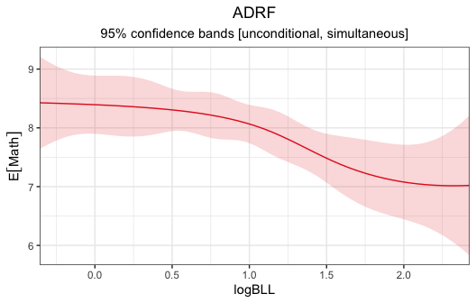
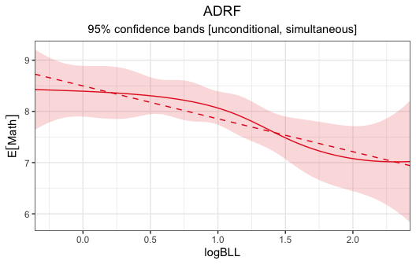
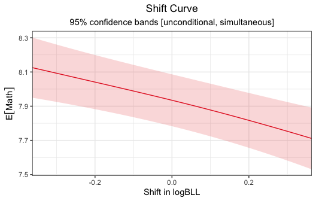

<!-- README.md is generated from README.Rmd. Please edit that file -->

# *adrftools*: Estimating, Visualizing, and Testing Average Dose-Response Functions

<!-- badges: start -->

<!-- [](https://CRAN.R-project.org/package=adrftools) -->

## <!-- badges: end -->

### Overview

*adrftools* is an R package for estimating the average dose-response
function (ADRF), which characterizes the effect of a continuous
treatment on an outcome. Functionality is included for performing
g-computation on a regression model to estimate the ADRF, plot the ADRF,
and test hypotheses about the ADRF, as well as for estimating shift
curves and the average derivative effect (ADE), which describe the
effects of changing the treatment each unit actually received. See
`vignette("adrftools")` for a full tutorial on using *adrftools*.

### Installation

You can install the current stable version of *adrftools* from CRAN
with:

``` r
install.packages("adrftools")
```

You can install the development version of *adrftools* from
[GitHub](https://github.com/ngreifer/adrftools) with:

``` r
# install.packages("pak")
pak::pak("ngreifer/adrftools")
```

### Example

Below we use *adrftools* to estimate and characterize the effect of
blood lead levels on scores on a cognitive test, adjusting for potential
confounders using g-computation.

``` r
library(adrftools)

data("nhanes3lead")
```

Here, the treatment is `logBLL`, the outcome is `Math`, and the
confounders to be adjusted for are `Age`, `Male`, `Race`, `PIR`,
`Enough_Food`, `Smoke_in_Home`, `Smoke_Pregnant`, and `NICU`. We’ll
first fit an outcome model that adjusts for these confounders.

``` r
fit <- lm(Math ~ splines::ns(logBLL, df = 5) * 
            (Age + Race + Male + PIR + Enough_Food +
               Smoke_in_Home + Smoke_Pregnant + NICU),
          data = nhanes3lead)
```

#### Computing the ADRF

Next we’ll use `adrftools::adrf()` to compute the ADRF.

``` r
adrf_bll <- adrf(fit, treat = "logBLL")

adrf_bll
```

    #> An <effect_curve> object
    #> 
    #>  - curve type: ADRF
    #>  - response: Math
    #>  - treatment: logBLL
    #>    + range: -0.3567 to 2.4248
    #>  - inference: unconditional

We can plot the ADRF using `plot()`:

``` r
plot(adrf_bll)
```



By default, this produces simultaneous 95% confidence bands.

`adrf_bll` is an `<effect_curve>` object, which is a function. We can
supply to it values of the treatment to compute the corresponding value
of the ADRF at those treatment values:

``` r
adrf_bll(logBLL = c(0, .5, 1, 1.5, 2))
```

    #>  ADRF Estimates
    #> ────────────────
    #>  logBLL Estimate
    #>     0.0    8.394
    #>     0.5    8.305
    #>     1.0    8.066
    #>     1.5    7.484
    #>     2.0    7.078
    #> ────────────────

We can also produce confidence intervals using `summary()` on the above
output:

``` r
adrf_bll(logBLL = c(0, .5, 1, 1.5, 2)) |>
  summary()
```

    #>               ADRF Estimates
    #> ──────────────────────────────────────────
    #>  logBLL Estimate Std. Error CI Low CI High
    #>     0.0    8.394     0.1740  7.950   8.838
    #>     0.5    8.305     0.1264  7.983   8.628
    #>     1.0    8.066     0.1141  7.775   8.357
    #>     1.5    7.484     0.1462  7.111   7.857
    #>     2.0    7.078     0.2232  6.508   7.647
    #> ──────────────────────────────────────────
    #> Inference: unconditional, simultaneous
    #> Confidence level: 95% (t* = 2.551, df = 2455)

To test an omnibus hypothesis about the ADRF, such as whether it is flat
or linear, we can use `summary()` on the `<effect_curve>` object itself:

``` r
# Test for flatness
summary(adrf_bll, hypothesis = "flat")
```

    #>                   Omnibus Curve Test
    #> ───────────────────────────────────────────────────────
    #> H₀: ADRF is flat for values of logBLL between -0.3567
    #>     and 2.4248
    #> 
    #>   P-value
    #>  < 0.0001
    #> ───────────────────────────────────────────────────────
    #> Computed using the Imhof approximation
    #>   * Saddlepoint approximation used for p-values below .0001

``` r
# Test for linearity
summary(adrf_bll, hypothesis = "linear")
```

    #>                   Omnibus Curve Test
    #> ───────────────────────────────────────────────────────
    #> H₀: ADRF is linear for values of logBLL between
    #>     -0.3567 and 2.4248
    #> 
    #>  P-value
    #>   0.3415
    #> ───────────────────────────────────────────────────────
    #> Computed using the Imhof approximation

The results indicate that the ADRF is not flat, but there isn’t enough
evidence to claim it is nonlinear in the range specified. We might
project a linear model onto the ADRF to produce a more interpretable
summary:

``` r
proj <- curve_projection(adrf_bll, model = "linear")
```

Below, we plot the linear projection along with the original ADRF:

``` r
plot(adrf_bll, proj = proj)
```



To examine the coefficient describing the projection, we can use
`summary()` on the projection:

``` r
summary(proj)
```

    #>                  ADRF Projection Coefficients
    #> ──────────────────────────────────────────────────────────────
    #>         Term Estimate Std. Error     t  P-value CI Low CI High
    #>  (Intercept)    8.498     0.1358 62.58 < 0.0001  8.232   8.764
    #>       logBLL   -0.642     0.1299 -4.94 < 0.0001 -0.897  -0.388
    #> ──────────────────────────────────────────────────────────────
    #> Inference: unconditional
    #> Confidence level: 95% (t* = 1.961, df = 2455)
    #> Null value: 0

Based on the above, we might conclude the following:

> There is some relationship between `logBLL` and `Math` adjusting for
> the included potential confounders, based on rejection of the
> hypothesis that the ADRF is flat for `logBLL` values between -0.3567
> and 2.4248 (p \< .0001). There isn’t evidence that the ADRF is
> nonlinear within this range (p = .3415). The linear projection has a
> coefficient of -.642 (p \< .0001), indicating that the expected
> potential outcome of `Math` decreases by this amount for each unit
> increase in `logBLL`.

#### Computing the Shift Curve and ADE

The ADRF describes the expected outcome if every unit received the same
value of the treatment, which requires that every unit could have
received every value in the range of the ADRF. An alternative is the
shift curve, which describes the expected outcome if each unit’s
treatment were shifted from the value it actually received, and its
derivative at a shift of 0, the ADE. These require only that units could
have received treatment values near those they actually received. We can
compute the shift curve using `shift_curve()`, which works like `adrf()`
but takes the size of the shift as its argument:

``` r
sc_bll <- shift_curve(fit, treat = "logBLL")

plot(sc_bll)
```



By default, the shifts range from half a standard deviation of the
treatment below to half a standard deviation above the value each unit
received. We can compute the ADE from the shift curve using `ade()` and
perform inference on it using `summary()`:

``` r
ade_bll <- ade(sc_bll)

summary(ade_bll)
```

    #>         Average Derivative Effect Estimates
    #> ───────────────────────────────────────────────────
    #>  Estimate Std. Error     t  P-value  CI Low CI High
    #>   -0.5528     0.1073 -5.15 < 0.0001 -0.7633 -0.3423
    #> ───────────────────────────────────────────────────
    #> Inference: unconditional, pointwise
    #> Confidence level: 95% (t* = 1.961, df = 2455)
    #> Null value: 0

The ADE of -.553 indicates that increasing every child’s `logBLL` by a
small amount would change the expected value of `Math` by approximately
-.553 times the size of that increase. See `vignette("shift-effects")`
for more information on shift curves and the ADE, including the effects
of specific shifts, other kinds of shifts, and how the ADE relates to
the ADRF.

See `vignette("adrftools")` for more information on how to use
*adrftools* and the other features available.

### Citing *adrftools*

Please cite *adrftools* when using it for analysis presented in
publications. A citation can be generated using `citation("adrftools")`
in R. For reproducibility purposes, it is also important to include the
version number for the version used.
