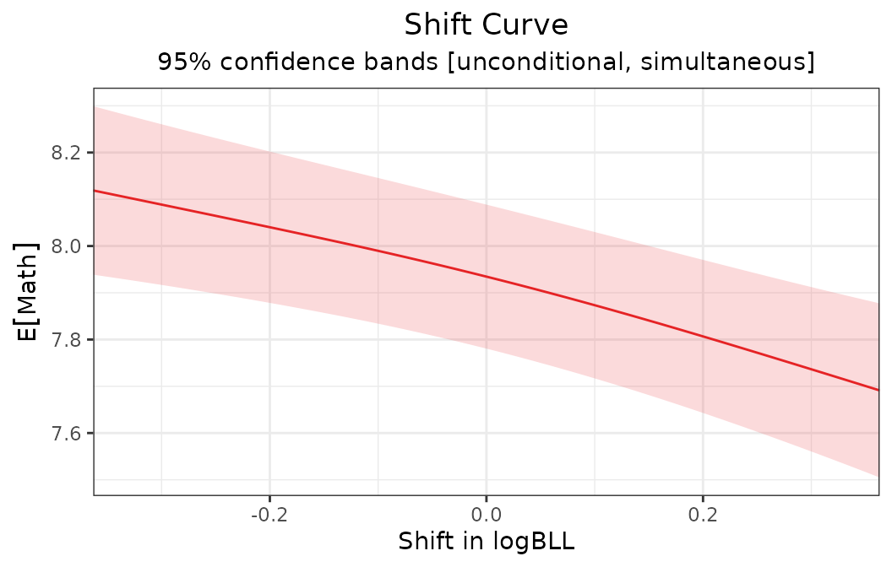
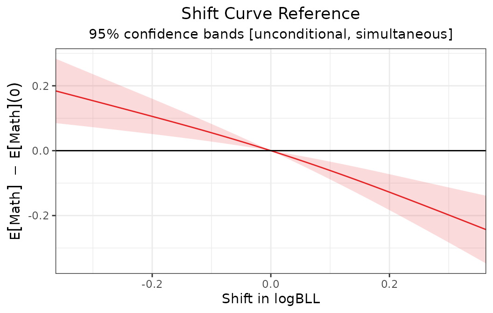
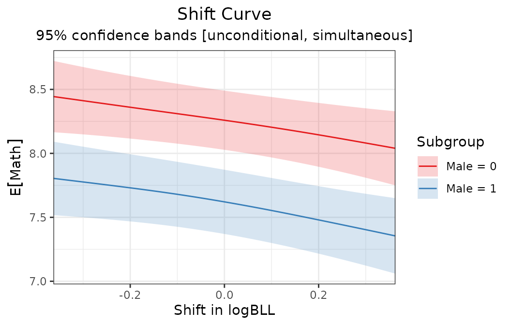
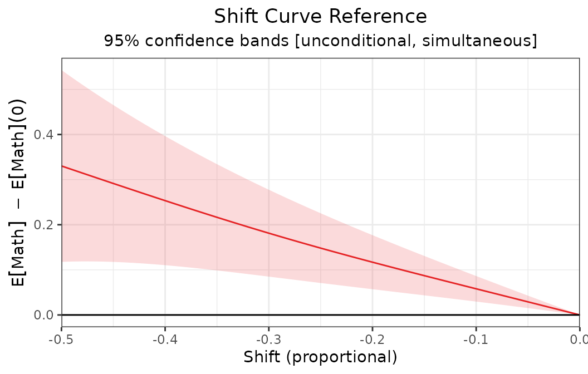
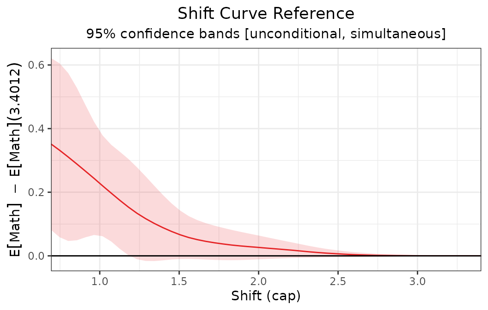

# Shift Interventions and Average Derivative Effects

## Introduction

The average dose-response function (ADRF), \\\theta\_\text{ADRF}(a) =
E\[Y(a)\]\\, describes the expected outcome if every unit in the
population received treatment value \\a\\. Estimating it requires that
every unit could have received every treatment value in the range of the
ADRF, which is a strong requirement when the treatment is strongly
related to the covariates. For example, if children from low-income
households rarely have low blood lead levels, the ADRF at low blood lead
levels depends on what the outcome model predicts for low-income
children at blood lead levels few such children have, which involves
extrapolation from the model rather than information in the data
([Lundberg and Brand 2026](#ref-lundbergCausalInferenceContinuous2026)).
See
[`vignette("adrftools")`](https://ngreifer.github.io/adrftools/articles/adrftools.md)
for estimating and characterizing the ADRF itself.

An alternative is to ask what would happen if each unit’s treatment were
changed from the value it actually received rather than set to the same
value for everyone. Interventions of this kind, which depend on the
treatment each unit would otherwise have received, are known as modified
treatment policies or shift interventions ([Díaz Muñoz and Laan
2012](#ref-diazmunozPopulationInterventionCausal2012); [Haneuse and
Rotnitzky 2013](#ref-haneuseEstimationEffectInterventions2013)). For a
function \\g(a, \delta)\\ that maps a unit’s observed treatment \\a\\
and a shift \\\delta\\ to a new treatment value, the shift curve is \\
\psi(\delta) = E\[Y(g(A, \delta))\] \\where \\A\\ is the treatment each
unit received. The simplest and most common choice is the additive
shift, \\g(a, \delta) = a + \delta\\, for which \\\psi(\delta)\\ is the
expected outcome if every unit’s treatment were increased by \\\delta\\
(or decreased, when \\\delta\\ is negative). With \\\delta = 0\\, every
unit receives the treatment it actually received, so \\\psi(0)\\ is the
mean outcome in the population. Under the usual causal assumptions, the
shift curve is identified as \\ E\[Y(g(A, \delta))\] = E\left\[ \mu(g(A,
\delta), X) \right\] \\where \\\mu(a, x) = E\[Y\|A = a, X = x\]\\ is the
expected outcome given treatment \\a\\ and covariates \\x\\ and the
outer expectation is over the joint distribution of the treatment and
covariates ([Haneuse and Rotnitzky
2013](#ref-haneuseEstimationEffectInterventions2013)). This requires
that units could have received treatment values near those they actually
received, which is a much weaker requirement than that every unit could
have received every value, as long as the shift is small.

The derivative of the additive shift curve at a shift of 0 is the
average derivative effect (ADE), \\ \theta\_\text{ADE} =
\frac{d\psi(\delta)}{d\delta}\Bigr\|\_{\delta = 0} =
E\left\[\frac{\partial \mu(A, X)}{\partial a}\right\] \\The ADE is the
slope of the outcome with respect to the treatment for each unit at the
treatment it actually received, averaged over units; it is the change in
the mean outcome per unit of an infinitesimal shift in every unit’s
treatment. Because it involves only treatment values arbitrarily close
to those actually received, it requires positivity only locally, and
because it is a single number, it can serve as a summary of the effect
of a continuous treatment much as the average treatment effect does for
a binary one ([Hines et al.
2026](#ref-hinesParameterizingEffectContinuous2026)).

### Shift Curves and the ADE in *adrftools*

*adrftools* estimates shift curves using g-computation with
[`shift_curve()`](https://ngreifer.github.io/adrftools/reference/shift_curve.md),
which works like
[`adrf()`](https://ngreifer.github.io/adrftools/reference/adrf.md): it
takes a fitted outcome model and the name of the treatment and returns
an `<effect_curve>` object, but its argument is the shift rather than
the treatment. All functions that operate on effect curves work with
shift curves as well, including
[`plot()`](https://rdrr.io/r/graphics/plot.default.html),
[`summary()`](https://rdrr.io/r/base/summary.html),
[`reference_curve()`](https://ngreifer.github.io/adrftools/reference/reference_curve.md),
[`curve_contrast()`](https://ngreifer.github.io/adrftools/reference/curve_contrast.md),
[`curve_projection()`](https://ngreifer.github.io/adrftools/reference/curve_projection.md),
and [`amef()`](https://ngreifer.github.io/adrftools/reference/amef.md).
[`ade()`](https://ngreifer.github.io/adrftools/reference/ade.md)
computes the ADE from a shift curve.

Inference uses the same machinery as
[`adrf()`](https://ngreifer.github.io/adrftools/reference/adrf.md). By
default, standard errors are unconditional, accounting for sampling from
the population as well as for estimation of the outcome model ([Hansen
and Overgaard 2024](#ref-hansenVarianceEstimationAverage2024)). Because
the shifted treatment of each unit depends on the treatment it received,
the unconditional standard errors account for the sampling of the
treatment along with that of the covariates. The ADE can also be
computed with
[`marginaleffects::avg_slopes()`](https://rdrr.io/pkg/marginaleffects/man/slopes.html)
([Arel-Bundock et al.
2024](#ref-arel-bundockHowInterpretStatistical2024)), which by default
treats the sample as fixed; we compare the two below.

### This Guide

In this guide, we will walk through an analysis of the effect of blood
lead levels on cognitive test scores using shift interventions. First
we’ll fit the outcome model and compute and plot the shift curve. Next
we’ll consider the size of the shift and compute the effects of specific
shifts and the ADE, and compare the ADE to the summaries of the ADRF
described in
[`vignette("adrftools")`](https://ngreifer.github.io/adrftools/articles/adrftools.md).
Then we’ll examine subgroup differences and other kinds of shifts, and
finally other scenarios that require special attention. First we’ll load
*adrftools* using [`library()`](https://rdrr.io/r/base/library.html).

``` r

library(adrftools)
```

## The Data

We use the `nhanes3lead` dataset that comes with *adrftools*, a subset
of the NHANES III survey, also used in
[`vignette("adrftools")`](https://ngreifer.github.io/adrftools/articles/adrftools.md).

``` r

data("nhanes3lead")
```

The treatment is `logBLL`, the natural log of blood lead levels in
μg/dL, and the outcome is `Math`, the score on the WISC Math test.
Covariates include `Age`, `Male`, `Race`, `PIR`, `Enough_Food`,
`Smoke_in_Home`, `Smoke_Pregnant`, and `NICU`.

## Analysis

We will use *adrftools* to answer the following research questions:

- How would the average Math score change if every child’s blood lead
  level were shifted up or down?
- What is the effect of a small change in blood lead levels, summarized
  as a single number?
- How does that number relate to the ADRF?
- Do the effects of shifts in blood lead levels differ between boys and
  girls?
- What would happen if blood lead levels were reduced by a given
  proportion or capped at a given level?

### Fitting the outcome model

As with the ADRF, the first step is to fit a flexible outcome model,
whose coefficients we will not interpret. Below, we use
[`lm()`](https://rdrr.io/r/stats/lm.html) to fit a linear regression of
`Math` on `logBLL`, entered as a natural cubic spline with 5 degrees of
freedom, the covariates, and their interactions, allowing the
relationship to differ by `Male`. This is the same model used in
[`vignette("adrftools")`](https://ngreifer.github.io/adrftools/articles/adrftools.md).

``` r

fit <- lm(Math ~ splines::ns(logBLL, df = 5) * Male *
            (Age + Race + PIR + Enough_Food +
               Smoke_in_Home + Smoke_Pregnant + NICU),
          data = nhanes3lead)
```

### Computing and plotting the shift curve

To compute the shift curve, we supply the outcome model to
[`shift_curve()`](https://ngreifer.github.io/adrftools/reference/shift_curve.md)
along with the name of the treatment.

``` r

sc_bll <- shift_curve(fit, treat = "logBLL")
```

Printing the object displays information about the shift curve.

``` r

sc_bll
## An <effect_curve> object
## 
##  - curve type: shift curve
##  - response: Math
##  - treatment: logBLL
##  - shift: additive
##    + range: -0.3631 to 0.3631 (-0.5 to 0.5 SD)
##  - inference: unconditional
```

By default, the shift is additive (`shift_fun = "additive"`), and the
shift curve is computed for shifts from half a standard deviation of the
treatment below to half a standard deviation above the treatment each
unit received. The standard deviation of `logBLL` is 0.726, so the
shifts range from -0.363 to 0.363 on the log scale. The range is printed
in the units of the treatment and, in parentheses, in standard
deviations.

Like an ADRF, a shift curve is a function. To display the estimates at
shifts of -.3, 0, and .3, we supply those values to the `shift` argument
and call [`summary()`](https://rdrr.io/r/base/summary.html) on the
output:

``` r

sc_bll(shift = c(-.3, 0, .3)) |>
  summary()
##           Shift Curve Estimates
## ─────────────────────────────────────────
##  shift Estimate Std. Error CI Low CI High
##   -0.3    8.089     0.0748  7.921   8.256
##    0.0    7.935     0.0670  7.784   8.085
##    0.3    7.736     0.0765  7.565   7.908
## ─────────────────────────────────────────
## Inference: unconditional, simultaneous
## Confidence level: 95% (t* = 2.24, df = 2401)
```

The estimate at a shift of 0 is the mean of the predicted outcomes at
the treatment values the children actually received, which, for a linear
model with an intercept, is the mean of `Math` in the sample. The
estimate at a shift of -.3 is the expected mean Math score if every
child’s `logBLL` were .3 lower than it was, which corresponds to blood
lead levels about 26% lower.

We can plot the shift curve with
[`plot()`](https://rdrr.io/r/graphics/plot.default.html):

``` r

plot(sc_bll)
```



The x-axis is the shift and the y-axis is the expected outcome under
that shift. As with the ADRF, the shaded region is the 95% simultaneous
confidence band. The shift curve slopes downward, indicating that
shifting every child’s blood lead level upward would lower average Math
scores and shifting it downward would raise them.

### Choosing the size of the shift

The size of the shift is controlled by the `shift` argument. A single
number `s` requests shifts from `-s` to `s`; for an additive shift, it
is in standard deviations of the treatment, so the default `shift = .5`
means half a standard deviation in each direction. Two numbers request
the lower and upper bounds of the shift in the units of the treatment;
for example, `shift = c(-1, 0)` requests shifts from a decrease of 1 to
no change.

The advantage of shift interventions over the ADRF holds only for small
shifts. A large shift moves some units to treatment values that units
like them rarely receive, at which point the shift curve depends on
extrapolation from the outcome model just as the ADRF does ([Lundberg
and Brand 2026](#ref-lundbergCausalInferenceContinuous2026)). One simple
check is how many units are moved beyond the range of the observed
treatment values. Below, we compute the proportion of children whose
`logBLL` would fall below the smallest observed value or above the
largest observed value under the largest shifts in the default range:

``` r

s <- .5 * sd(nhanes3lead$logBLL)

# Proportion moved below the smallest observed value
mean(nhanes3lead$logBLL - s < min(nhanes3lead$logBLL))
## [1] 0.1082904

# Proportion moved above the largest observed value
mean(nhanes3lead$logBLL + s > max(nhanes3lead$logBLL))
## [1] 0.003570012
```

About 11% of children would be moved below the lowest observed blood
lead level by the largest downward shift, because many children have
blood lead levels near the minimum, whereas very few would be moved
above the highest one. Estimates for large downward shifts therefore
rely on extrapolation for some children, which suggests focusing on
smaller shifts in that direction. This check concerns the marginal
distribution of the treatment; a shift can also move units to values
that are within the observed range but rare among units with similar
covariates. Ideally, the size of the shift should be chosen to be
substantively meaningful (e.g., corresponding to a feasible
intervention) and small relative to the variation of the treatment among
units with similar covariates.

The grid of shifts is treated as fixed in computing standard errors, as
the range of the ADRF is in
[`adrf()`](https://ngreifer.github.io/adrftools/reference/adrf.md), even
though, when `shift` is a single number, it depends on the standard
deviation of the treatment in the sample.

### Effects of shifts

The shift curve gives expected outcomes under each shift; the effect of
a shift is the difference between the expected outcome under that shift
and that under no shift. We can compute these differences using
[`reference_curve()`](https://ngreifer.github.io/adrftools/reference/reference_curve.md)
with `reference = 0`:

``` r

sc_bll_ref <- reference_curve(sc_bll, reference = 0)
```

Plotting the reference curve displays the effect of each shift, with a
horizontal line at 0 indicating no effect.

``` r

plot(sc_bll_ref)
```



The confidence band narrows near a shift of 0, because the effects of
small shifts are estimated more precisely. Below, we estimate the
effects of a few specific shifts:

``` r

est_ref <- sc_bll_ref(shift = c(-.3, -.1, .1, .3))

summary(est_ref)
##              Shift Curve Reference Estimates
## ──────────────────────────────────────────────────────────
##  shift Estimate Std. Error      t  P-value  CI Low CI High
##   -0.3   0.1541     0.0359  4.289 < 0.0001  0.0741  0.2341
##   -0.1   0.0552     0.0120  4.607 < 0.0001  0.0285  0.0818
##    0.1  -0.0612     0.0120 -5.083 < 0.0001 -0.0879 -0.0344
##    0.3  -0.1982     0.0373 -5.313 < 0.0001 -0.2812 -0.1151
## ──────────────────────────────────────────────────────────
## Inference: unconditional, simultaneous
## Confidence level: 95% (t* = 2.226, df = 2401)
## Reference: shift = 0 | Null value: 0
```

For example, decreasing every child’s `logBLL` by .3 would increase the
average Math score by an estimated 0.154 points, with a 95% simultaneous
confidence interval excluding 0.

To test whether any shift in the range changes the average outcome, we
can use [`summary()`](https://rdrr.io/r/base/summary.html) on the shift
curve itself, which tests whether the shift curve is flat (see
[`vignette("adrftools")`](https://ngreifer.github.io/adrftools/articles/adrftools.md)
for details on these tests):

``` r

summary(sc_bll)
##                   Omnibus Curve Test
## ───────────────────────────────────────────────────────
## H₀: shift curve is flat for values of shift between
##     -0.3631 and 0.3631
## 
##   P-value
##  < 0.0001
## ───────────────────────────────────────────────────────
## Computed using the Imhof approximation (the
##   saddlepoint approximation for p-values below .0001)
```

The small p-value indicates that at least some shifts in the range
change the average Math score. We can also test whether the shift curve
is linear in the range of shifts:

``` r

summary(sc_bll, hypothesis = "linear")
##                   Omnibus Curve Test
## ───────────────────────────────────────────────────────
## H₀: shift curve is linear for values of shift between
##     -0.3631 and 0.3631
## 
##  P-value
##   0.1335
## ───────────────────────────────────────────────────────
## Computed using the Imhof approximation (the
##   saddlepoint approximation for p-values below .0001)
```

We cannot reject the null hypothesis that the shift curve is linear, so
there isn’t evidence that the effects of the shifts in this range depart
from being proportional to their size. This makes the ADE, described
next, a reasonable summary of the effects of the shifts.

### The average derivative effect

To compute the ADE, we supply the shift curve to
[`ade()`](https://ngreifer.github.io/adrftools/reference/ade.md) and use
[`summary()`](https://rdrr.io/r/base/summary.html) on the output to
perform inference:

``` r

ade_bll <- ade(sc_bll)

summary(ade_bll)
##         Average Derivative Effect Estimates
## ────────────────────────────────────────────────────
##  Estimate Std. Error      t  P-value  CI Low CI High
##   -0.5809     0.1199 -4.846 < 0.0001 -0.8159 -0.3458
## ────────────────────────────────────────────────────
## Inference: unconditional, pointwise
## Confidence level: 95% (t* = 1.961, df = 2401)
## Null value: 0
```

The ADE of -0.581 means that shifting every child’s `logBLL` upward by a
small amount would change the average Math score by approximately -0.581
times the size of that shift. For example, a shift of -.1 would increase
the average Math score by approximately 0.058 points, which is close to
the estimate of 0.055 for that shift computed above. The confidence
interval excludes 0, so we can conclude that small shifts in blood lead
levels affect Math scores.

[`ade()`](https://ngreifer.github.io/adrftools/reference/ade.md)
computes the ADE as the derivative of the shift curve at a shift of 0,
using the same numerical differentiation as
[`amef()`](https://ngreifer.github.io/adrftools/reference/amef.md), and
computes its standard error from that of the shift curve using the delta
method (or from the bootstrap replicates or posterior draws when those
are used). For smooth outcome models such as this one, the result does
not depend on the range of shifts in the shift curve, as long as it
includes 0, and agrees with the ADE computed directly from the slopes of
the predictions, as
[`marginaleffects::avg_slopes()`](https://rdrr.io/pkg/marginaleffects/man/slopes.html)
does:

``` r

marginaleffects::avg_slopes(fit, variables = "logBLL")
## 
##  Estimate Std. Error    z Pr(>|z|)    S  2.5 % 97.5 %
##    -0.581      0.108 -5.4   <0.001 23.8 -0.792  -0.37
## 
## Term: logBLL
## Type: response
## Comparison: dY/dX
```

The estimates are the same, but the standard error from `avg_slopes()`
is smaller because by default it is conditional on the sample, treating
the covariates and treatment values as fixed. The unconditional standard
error from
[`ade()`](https://ngreifer.github.io/adrftools/reference/ade.md)
additionally accounts for the variation of the slope across children,
which is appropriate when the ADE is to generalize to the population
from which the sample was drawn. Setting `vcov = "conditional"` in the
call to
[`shift_curve()`](https://ngreifer.github.io/adrftools/reference/shift_curve.md)
reproduces the conditional standard error; we demonstrate this in the
section “Additional Scenarios” below.

### The ADE, the AMEF, and the projection of the ADRF

[`vignette("adrftools")`](https://ngreifer.github.io/adrftools/articles/adrftools.md)
describes other ways of summarizing the effect of a continuous
treatment, in particular the average marginal effect function (AMEF),
the derivative of the ADRF, and the slope of the linear projection of
the ADRF. These are related to the ADE but answer different questions.

The AMEF at a treatment value \\a\\ averages the slope of the outcome at
\\a\\ over the distribution of the covariates in the whole population,
whereas the ADE averages each unit’s slope at the treatment value it
actually received. The slope of the linear projection of the ADRF is a
weighted average of the AMEF across treatment values, with weights
determined by `integrate`; with `integrate = "empirical"`, the weights
depend on the distribution of the treatment, but at each treatment
value, the slope is still averaged over the covariates of all units.
When the treatment is unrelated to the covariates (e.g., in a randomized
trial), the ADE equals the average of the AMEF over the distribution of
the treatment, but not the slope of the projection, whose weights differ
from that distribution; the two agree in that case only when the ADRF is
linear. When the treatment is related to the covariates, the ADE also
differs from the average of the AMEF: it gives more weight to the slopes
of the units most likely to receive each treatment value, and it does
not require that every unit could have received every treatment value.
The projection slopes are computed below:

``` r

adrf_bll <- adrf(fit, treat = "logBLL")

# Projection with uniform weighting
curve_projection(adrf_bll, "linear") |>
  summary()
##                  ADRF Projection Coefficients
## ──────────────────────────────────────────────────────────────
##         Term Estimate Std. Error     t  P-value CI Low CI High
##  (Intercept)    8.485     0.1381 61.46 < 0.0001  8.215   8.756
##       logBLL   -0.612     0.1343 -4.56 < 0.0001 -0.876  -0.349
## ──────────────────────────────────────────────────────────────
## Inference: unconditional
## Confidence level: 95% (t* = 1.961, df = 2401)
## Null value: 0

# Projection weighted by the treatment density
curve_projection(adrf_bll, "linear", integrate = "empirical") |>
  summary()
##                  ADRF Projection Coefficients
## ──────────────────────────────────────────────────────────────
##         Term Estimate Std. Error     t  P-value CI Low CI High
##  (Intercept)    8.563     0.1342 63.81 < 0.0001  8.300   8.826
##       logBLL   -0.658     0.1272 -5.17 < 0.0001 -0.907  -0.408
## ──────────────────────────────────────────────────────────────
## Inference: unconditional
## Confidence level: 95% (t* = 1.961, df = 2401)
## Null value: 0
```

Here, the slopes of the linear projections are somewhat steeper than the
ADE, though all three indicate a similar negative effect. Which summary
to report depends on the question of interest: the projection slope
describes the shape of the ADRF, the effect of setting everyone’s
treatment to each value, whereas the ADE describes the effect of small
changes to the treatment children actually received, which relies on
weaker assumptions ([Hines et al.
2026](#ref-hinesParameterizingEffectContinuous2026)).

### Subgroup shift curves and ADEs

As with
[`adrf()`](https://ngreifer.github.io/adrftools/reference/adrf.md), the
`by` argument to
[`shift_curve()`](https://ngreifer.github.io/adrftools/reference/shift_curve.md)
computes shift curves within subgroups. Below, we compute the shift
curve within levels of `Male`:

``` r

sc_bll_by_male <- shift_curve(fit, treat = "logBLL",
                              by = ~Male)
```

With an additive shift and `shift` supplied as a single number, the
shifts are in standard deviations of the treatment computed over both
subgroups pooled, so the subgroups have the same grid of shifts and
their shift curves can be contrasted. We can plot the shift curves for
both groups:

``` r

plot(sc_bll_by_male)
```



Calling [`ade()`](https://ngreifer.github.io/adrftools/reference/ade.md)
on the subgroup shift curve computes the ADE within each subgroup:

``` r

ade(sc_bll_by_male) |>
  summary()
##           Average Derivative Effect Estimates
## ────────────────────────────────────────────────────────
##  Male Estimate Std. Error      t P-value  CI Low CI High
##     0  -0.5254     0.1707 -3.078  0.0042 -0.9074 -0.1434
##     1  -0.6344     0.1683 -3.769  0.0003 -1.0111 -0.2578
## ────────────────────────────────────────────────────────
## Inference: unconditional, simultaneous
## Confidence level: 95% (t* = 2.238, df = 2401)
## Null value: 0
```

To compare subgroups, we can use
[`curve_contrast()`](https://ngreifer.github.io/adrftools/reference/curve_contrast.md).
It is important to choose what is being contrasted. Contrasting the
shift curves themselves compares the expected outcomes under each shift,
which differ when the subgroups differ in their average outcomes even if
the shifts have the same effects in both. Below, we test whether the
shift curves differ between boys and girls:

``` r

curve_contrast(sc_bll_by_male) |>
  summary()
##                   Omnibus Curve Test
## ───────────────────────────────────────────────────────
## H₀: shift curve contrast is 0 for values of shift
##     between -0.3631 and 0.3631
## 
##                 Contrast  P-value
##  [Male = 1] - [Male = 0] < 0.0001
## ───────────────────────────────────────────────────────
## Computed using the Imhof approximation (the
##   saddlepoint approximation for p-values below .0001)
```

The small p-value indicates that the expected Math scores differ between
boys and girls, but not necessarily that the effects of the shifts
differ. To compare the effects of the shifts, we can contrast the
reference curves, which compare the effect of each shift relative to no
shift:

``` r

sc_bll_ref_contrast <- sc_bll_by_male |>
  reference_curve(reference = 0) |>
  curve_contrast()

summary(sc_bll_ref_contrast)
##                   Omnibus Curve Test
## ───────────────────────────────────────────────────────
## H₀: shift curve contrast difference from reference
##     (shift = 0) is 0 for values of shift between
##     -0.3631 and 0.3631
## 
##                 Contrast P-value
##  [Male = 1] - [Male = 0]   0.812
## ───────────────────────────────────────────────────────
## Computed using the Imhof approximation (the
##   saddlepoint approximation for p-values below .0001)
```

Here, we cannot reject the null hypothesis that the effects of the
shifts are the same for boys and girls. Similarly,
[`ade()`](https://ngreifer.github.io/adrftools/reference/ade.md) applied
to a contrast of shift curves computes the difference between the ADEs
in the subgroups:

``` r

curve_contrast(sc_bll_by_male) |>
  ade() |>
  summary()
##                 Average Derivative Effect Contrast Estimates
## ────────────────────────────────────────────────────────────────────────────
##                 Contrast Estimate Std. Error       t P-value  CI Low CI High
##  [Male = 1] - [Male = 0]   -0.109     0.2397 -0.4548  0.6493 -0.5791  0.3611
## ────────────────────────────────────────────────────────────────────────────
## Inference: unconditional, pointwise
## Confidence level: 95% (t* = 1.961, df = 2401)
## Null value: 0
```

The confidence interval for the difference between the ADEs is wide and
includes 0, so there isn’t evidence that small shifts in blood lead
levels affect Math scores differently for boys and girls. For other
approaches to characterizing the heterogeneity of the effects of shift
interventions, see Pal and Huling
([2026](#ref-palHeterogeneousEffectsContinuous2026)) and Lundberg and
Brand ([2026](#ref-lundbergCausalInferenceContinuous2026)).

### Other shift interventions

The additive shift is not the only intervention of interest. The
`shift_fun` argument to
[`shift_curve()`](https://ngreifer.github.io/adrftools/reference/shift_curve.md)
controls how each unit’s treatment is changed by the shift. Setting
`shift_fun = "multiplicative"` multiplies each unit’s treatment by 1
plus the shift, so that a shift of -.1 corresponds to a 10% decrease;
this can only be used when the treatment is nonnegative. More generally,
`shift_fun` can be a function of two arguments, the vector of observed
treatment values and a single value of the shift, that returns the
vector of shifted treatment values. This allows for a wide range of
modified treatment policies ([Haneuse and Rotnitzky
2013](#ref-haneuseEstimationEffectInterventions2013)).[^1]

#### Proportional reductions

Interventions on blood lead levels might be more naturally described as
reducing them by a proportion, e.g., by 10%, rather than by a fixed
amount on the log scale. Because our treatment is the log of blood lead
levels, multiplying blood lead levels by \\1 + \delta\\ adds \\\log(1 +
\delta)\\ to `logBLL`, so we can’t use `shift_fun = "multiplicative"`,
which would multiply `logBLL` itself. Instead, we define a function that
performs the corresponding shift on the log scale and supply it to
`shift_fun`. Giving the function a name means the name is used to
describe the shift when the shift curve is printed and plotted.

``` r

# Multiply each child's blood lead level by 1 + delta
proportional <- function(a, delta) a + log1p(delta)

sc_bll_prop <- shift_curve(fit, treat = "logBLL",
                           shift = c(-.5, 0),
                           shift_fun = proportional)

sc_bll_prop
## An <effect_curve> object
## 
##  - curve type: shift curve
##  - response: Math
##  - treatment: logBLL
##  - shift: proportional
##    + range: -0.5 to 0
##  - inference: unconditional
```

Here, the shifts range from -.5 (i.e., halving every child’s blood lead
level) to 0 (no change). As before, we use
[`reference_curve()`](https://ngreifer.github.io/adrftools/reference/reference_curve.md)
to compute the effects of the shifts relative to no shift and plot the
result:

``` r

sc_bll_prop_ref <- reference_curve(sc_bll_prop, reference = 0)

plot(sc_bll_prop_ref)
```



The x-axis is the proportional change in blood lead levels. Below, we
estimate the effects of specific proportional reductions:

``` r

sc_bll_prop_ref(shift = c(-.5, -.25, -.1)) |>
  summary()
##             Shift Curve Reference Estimates
## ────────────────────────────────────────────────────────
##  shift Estimate Std. Error     t  P-value CI Low CI High
##  -0.50   0.3303     0.0947 3.487   0.0009 0.1214  0.5391
##  -0.25   0.1482     0.0344 4.303 < 0.0001 0.0722  0.2241
##  -0.10   0.0580     0.0126 4.596 < 0.0001 0.0302  0.0858
## ────────────────────────────────────────────────────────
## Inference: unconditional, simultaneous
## Confidence level: 95% (t* = 2.205, df = 2401)
## Reference: shift = 0 | Null value: 0
```

Reducing every child’s blood lead level by 10% would increase the
average Math score by an estimated 0.058 points, and halving it would
increase the average Math score by 0.33 points, though the latter
involves large shifts that rely more on extrapolation.

Because \\\log(1 + \delta)\\ has a derivative of 1 at \\\delta = 0\\,
the ADE of this shift curve is the same as that of the additive shift
curve, but it has a different interpretation: it is the change in the
average Math score per unit proportional change in every child’s blood
lead level, so multiplying it by .01 gives the change for a 1% increase.

``` r

ade(sc_bll_prop) |>
  summary()
##         Average Derivative Effect Estimates
## ────────────────────────────────────────────────────
##  Estimate Std. Error      t  P-value  CI Low CI High
##   -0.5809     0.1199 -4.846 < 0.0001 -0.8159 -0.3458
## ────────────────────────────────────────────────────
## Inference: unconditional, pointwise
## Confidence level: 95% (t* = 1.961, df = 2401)
## Null value: 0
```

More generally, the ADE for a shift function \\g(a, \delta)\\ averages
each unit’s slope weighted by the derivative of \\g\\ with respect to
\\\delta\\ at 0. With `shift_fun = "multiplicative"`, this is \\E\[A \\
\partial \mu(A, X)/\partial a\]\\, which differs from the additive ADE
unless the slope is unrelated to the treatment.

#### Capping the treatment

A policy might aim to ensure that no child has a blood lead level above
a given threshold, leaving children below the threshold unaffected. The
shift curve for such a policy has the threshold as its argument, and the
shift function caps each unit’s treatment at the threshold using
[`pmin()`](https://rdrr.io/r/base/Extremes.html). Below, we define this
function and consider thresholds from 2 μg/dL to 30 μg/dL, which is
above the largest observed blood lead level, so that a cap at that value
leaves every child’s blood lead level unchanged:

``` r

# Cap each child's logBLL at delta
cap <- function(a, delta) pmin(a, delta)

sc_bll_cap <- shift_curve(fit, treat = "logBLL",
                          shift = log(c(2, 30)),
                          shift_fun = cap)
```

We use
[`reference_curve()`](https://ngreifer.github.io/adrftools/reference/reference_curve.md)
with `reference = log(30)` to compute the effects of each cap relative
to no cap, and plot the result:

``` r

sc_bll_cap_ref <- reference_curve(sc_bll_cap, reference = log(30))

plot(sc_bll_cap_ref)
```



The x-axis is the cap on `logBLL`, labeled with the name of the shift
function. Lower caps affect more children and have larger effects. We
can estimate the effects of caps at a few thresholds, such as 3.5, 5,
and 10 μg/dL:

``` r

sc_bll_cap_ref(shift = log(c(3.5, 5, 10))) |>
  summary()
##              Shift Curve Reference Estimates
## ──────────────────────────────────────────────────────────
##   shift Estimate Std. Error      t P-value  CI Low CI High
##  1.2528   0.1279     0.0506 2.5265  0.0318  0.0086  0.2471
##  1.6094   0.0515     0.0222 2.3203  0.0548 -0.0008  0.1037
##  2.3026   0.0134     0.0069 1.9280  0.1362 -0.0030  0.0298
## ──────────────────────────────────────────────────────────
## Inference: unconditional, simultaneous
## Confidence level: 95% (t* = 2.356, df = 2401)
## Reference: shift = 3.4012 | Null value: 0
```

Capping blood lead levels at 3.5 μg/dL would increase the average Math
score by an estimated 0.128 points. Positivity is a concern here as
well: a low cap moves children with high blood lead levels to values
that may be rare among children with their characteristics, and the
estimates for those children rely on the outcome model.
[`ade()`](https://ngreifer.github.io/adrftools/reference/ade.md) cannot
be used with this shift curve because a shift of 0 does not leave every
child’s treatment unchanged.

## Additional Scenarios

All the scenarios described in
[`vignette("adrftools")`](https://ngreifer.github.io/adrftools/articles/adrftools.md),
including nonlinear outcome models, balancing and sampling weights,
multiply imputed data, and Bayesian models, work the same way with
[`shift_curve()`](https://ngreifer.github.io/adrftools/reference/shift_curve.md)
as with
[`adrf()`](https://ngreifer.github.io/adrftools/reference/adrf.md).
Below, we briefly describe the differences specific to shift curves and
the ADE.

### Inference

As with
[`adrf()`](https://ngreifer.github.io/adrftools/reference/adrf.md), the
`vcov` argument to
[`shift_curve()`](https://ngreifer.github.io/adrftools/reference/shift_curve.md)
controls how uncertainty is estimated. Setting `vcov = "conditional"`
computes standard errors that treat the sample as fixed, which
reproduces those computed by
[`marginaleffects::avg_slopes()`](https://rdrr.io/pkg/marginaleffects/man/slopes.html)
for the ADE:

``` r

sc_bll_cond <- shift_curve(fit, treat = "logBLL",
                           vcov = "conditional")

ade(sc_bll_cond) |>
  summary()
##         Average Derivative Effect Estimates
## ────────────────────────────────────────────────────
##  Estimate Std. Error      t  P-value  CI Low CI High
##   -0.5809     0.1076 -5.397 < 0.0001 -0.7919 -0.3698
## ────────────────────────────────────────────────────
## Inference: conditional, pointwise
## Confidence level: 95% (t* = 1.961, df = 2401)
## Null value: 0
```

Setting `vcov = "fwb"` or `vcov = "boot"` uses the fractional weighted
or traditional bootstrap, respectively, which, like the default
unconditional standard errors, accounts for sampling from the
population. With the bootstrap, the ADE is computed in each bootstrap
replicate from that replicate’s shift curve, and percentile confidence
intervals are computed by default.

``` r

sc_bll_boot <- shift_curve(fit, treat = "logBLL",
                           vcov = "fwb",
                           fwb.args = list(R = 500, verbose = FALSE))

ade(sc_bll_boot) |>
  summary()
## Average Derivative Effect Estimates
## ──────────────────────────────────
##  Estimate  P-value  CI Low CI High
##   -0.5809 < 0.0001 -0.8239 -0.3588
## ──────────────────────────────────
## Inference: bootstrap, pointwise
## Confidence level: 95%
## Null value: 0
```

### Nonlinear outcome models

For a binary outcome, the shift curve is on the probability scale by
default, and its confidence intervals are computed on the transformed
(e.g., logit) scale and back-transformed, as for the ADRF. The ADE is
the average of each unit’s slope of the probability with respect to the
treatment. Below, we use a binarized version of `Block` as the outcome,
as in
[`vignette("adrftools")`](https://ngreifer.github.io/adrftools/articles/adrftools.md):

``` r

nhanes3lead$Block_bin <- as.integer(nhanes3lead$Block >= 12)

fit_bin <- glm(Block_bin ~ splines::ns(logBLL, df = 5) *
                 (Age + Male + Race + PIR + Enough_Food +
                    Smoke_in_Home + Smoke_Pregnant + NICU),
               data = nhanes3lead,
               family = binomial)

sc_bll_bin <- shift_curve(fit_bin, treat = "logBLL")

ade_bll_bin <- ade(sc_bll_bin)

summary(ade_bll_bin)
##         Average Derivative Effect Estimates
## ───────────────────────────────────────────────────
##  Estimate Std. Error      z P-value  CI Low CI High
##   -0.0465     0.0132 -3.526  0.0004 -0.0723 -0.0206
## ───────────────────────────────────────────────────
## Inference: unconditional, pointwise
## Confidence level: 95% (z* = 1.96)
## Null value: 0
```

The ADE of -0.0465 means that a small increase in every child’s `logBLL`
would change the probability of a high Block score by about -4.65
percentage points per unit of the shift.

### Bayesian models

With Bayesian models, the posterior draws of the shift curve are used
for inference on the shift curve and the ADE, as for the ADRF. One
caveat applies to models whose predictions are step functions of the
treatment, such as Bayesian additive regression trees \[BART; Hill
([2011](#ref-hillBayesianNonparametricModeling2011))\] with the usual
hard decision rules. For such models, the derivative of each unit’s
prediction with respect to the treatment is 0 almost everywhere, so the
ADE computed directly from the slopes of the predictions is not
meaningful. The ADE computed by
[`ade()`](https://ngreifer.github.io/adrftools/reference/ade.md)
reflects the change in the mean outcome over the spacing of the grid of
shifts instead, which depends on the `shift` and `n` arguments to
[`shift_curve()`](https://ngreifer.github.io/adrftools/reference/shift_curve.md).
In this case, it can be more informative to report the effects of
specific, small shifts using
[`reference_curve()`](https://ngreifer.github.io/adrftools/reference/reference_curve.md).
BART models with soft decision rules, whose predictions are smooth in
the treatment, do not have this problem, and the ADE computed from them
does not depend on the grid.

## References

Arel-Bundock, Vincent, Noah Greifer, and Andrew Heiss. 2024. “How to
Interpret Statistical Models Using Marginaleffects for r and Python.”
*Journal of Statistical Software* 111: 1–32.
<https://doi.org/10.18637/jss.v111.i09>.

Díaz Muñoz, Iván, and Mark van der Laan. 2012. “Population Intervention
Causal Effects Based on Stochastic Interventions.” *Biometrics* 68 (2):
541–49. <https://doi.org/10.1111/j.1541-0420.2011.01685.x>.

Haneuse, S., and A. Rotnitzky. 2013. “Estimation of the Effect of
Interventions That Modify the Received Treatment.” *Statistics in
Medicine* 32 (30): 5260–77. <https://doi.org/10.1002/sim.5907>.

Hansen, Stefan Nygaard, and Morten Overgaard. 2024. “Variance Estimation
for Average Treatment Effects Estimated by g-Computation.” *Metrika*,
ahead of print, April 6. <https://doi.org/10.1007/s00184-024-00962-4>.

Hill, Jennifer L. 2011. “Bayesian Nonparametric Modeling for Causal
Inference.” *Journal of Computational and Graphical Statistics* 20 (1):
217–40. <https://doi.org/10.1198/jcgs.2010.08162>.

Hines, Oliver J., Karla Diaz-Ordaz, and Stijn Vansteelandt. 2026.
“Parameterizing the Effect of a Continuous Treatment Using Average
Derivative Effects.” *Biometrika* 113 (2): asag012.
<https://doi.org/10.1093/biomet/asag012>.

Lundberg, Ian, and Jennie E. Brand. 2026. “Causal Inference with a
Continuous Treatment: Addressing Positivity Constraints, Nonlinearity,
and Effect Heterogeneity.” *Sociological Methodology* 56 (2): 206–36.
<https://doi.org/10.1177/00811750261459364>.

Pal, Samhita, and Jared D. Huling. 2026. *Heterogeneous Effects of
Continuous Treatments via Conditional Modified Treatment Policies*.
arXiv. <https://doi.org/10.48550/arXiv.2608.20744>.

[^1]: As an extreme example, supplying
    `shift_fun = function(a, delta) {a[] <- delta; a}` sets every unit’s
    treatment to `delta` regardless of the treatment it received, so the
    shift curve is the ADRF. The estimates and their standard errors are
    identical to those computed by
    [`adrf()`](https://ngreifer.github.io/adrftools/reference/adrf.md)
    over the same range.
